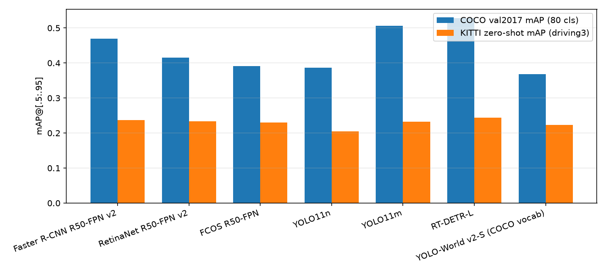
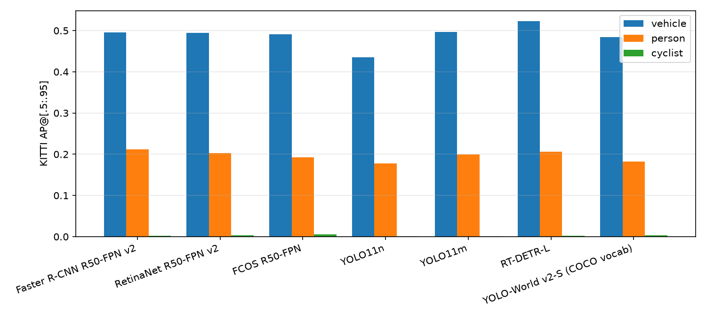
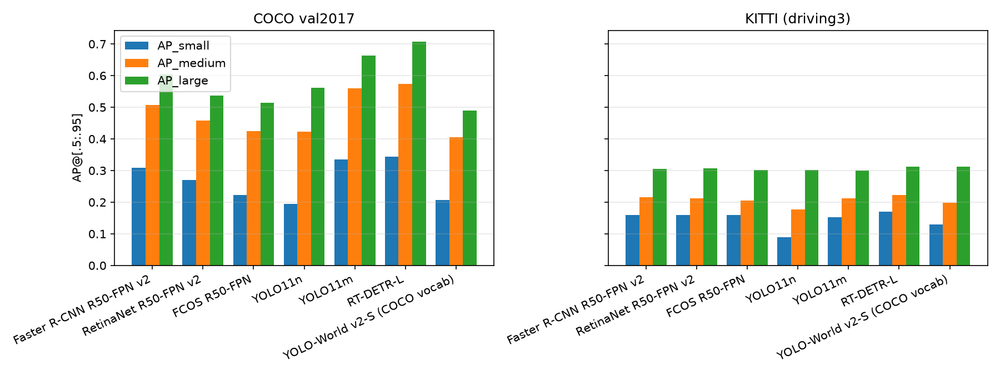
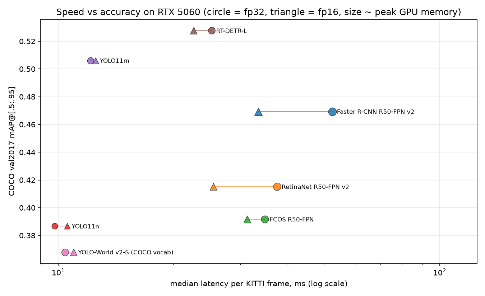
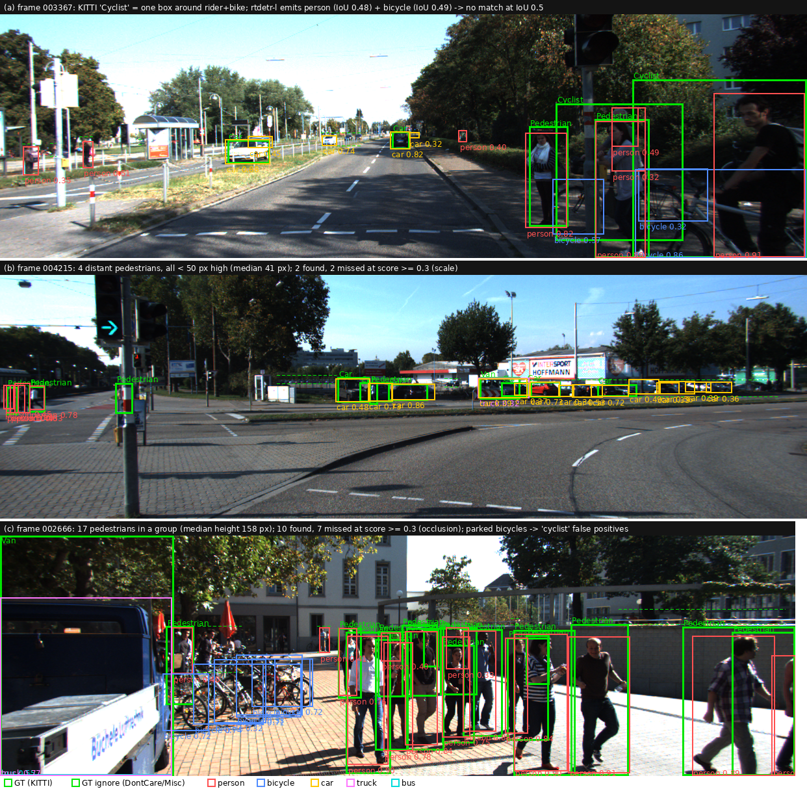

# 2D Object Detection — Track A: Experimental Model Evaluation

Zero-shot evaluation of seven COCO-pretrained detector configurations from five
detector families on COCO val2017 and on the KITTI 2D object-detection benchmark,
without any training or fine-tuning. The study measures accuracy (COCO-style
mAP, AP50/75, AP by object scale, per-class AP, AR), speed (latency, FPS) and
GPU memory, and analyses (1) cross-dataset generalisation (COCO → KITTI),
(2) architecture differences (two-stage vs one-stage vs YOLO vs DETR),
(3) closed-set vs open-vocabulary detection (YOLO11 vs YOLO-World) and
(4) the speed–accuracy trade-off.

Starting point: the course tutorial [15]
<https://github.com/lkk688/DeepDataMiningLearning/blob/main/DeepDataMiningLearning/ngdet/TUTORIAL.md>
(its `driving3` / `driving5` taxonomy presets and its "COCO-pretrained detector →
driving dataset without retraining" experiment are reproduced here with an
independent, minimal re-implementation in `src/`). All code, per-run metric
files, figures and the original console logs of every run are published at
<https://github.com/bhagyeshrathi07/2d-object-detection-track-a> (the logs are
in `results/logs/`; see Appendix A and `README.md`). The 1.2 GB of cached raw
detections is submitted separately because it exceeds GitHub's file-size limit.

---

## 1. Experimental setup

### 1.1 Hardware and software

| Item | Value |
|---|---|
| GPU | NVIDIA GeForce RTX 5060, 8 GB (Blackwell, compute capability 12.0), driver 621.01 |
| CPU | Intel Core Ultra 5 225F (10 cores) |
| OS | Windows 11 Home 10.0.26300 |
| Python | 3.12.10 (venv) |
| PyTorch / torchvision | 2.11.0+cu128 / 0.26.0+cu128 (CUDA 12.8 build — required for sm_120) |
| Ultralytics | 8.4.194 |
| pycocotools | 2.0.x (official COCO evaluation code) |
| Ultralytics CLIP fork | installed from GitHub archive (text encoder for YOLO-World prompts) |

### 1.2 Models and checkpoints

| # | Model | Family | Framework | Checkpoint | Params |
|---|---|---|---|---|---|
| 1 | Faster R-CNN ResNet50-FPN v2 [1, 2, 5] | two-stage, anchor-based | torchvision [13] | `FasterRCNN_ResNet50_FPN_V2_Weights.COCO_V1` | 43.7 M |
| 2 | RetinaNet ResNet50-FPN v2 [3, 5] | one-stage, anchor-based, focal loss | torchvision | `RetinaNet_ResNet50_FPN_V2_Weights.COCO_V1` | 38.2 M |
| 3 | FCOS ResNet50-FPN [4] | one-stage, anchor-free | torchvision | `FCOS_ResNet50_FPN_Weights.COCO_V1` | 32.3 M |
| 4 | YOLO11n [6] | one-stage, anchor-free, CNN | Ultralytics [6] | `yolo11n.pt` | 2.6 M |
| 5 | YOLO11m [6] | one-stage, anchor-free, CNN | Ultralytics | `yolo11m.pt` | 20.1 M |
| 6 | RT-DETR-L [7, 16] | real-time DETR (transformer decoder, NMS-free) | Ultralytics | `rtdetr-l.pt` | 33.0 M |
| 7 | YOLO-World v2-S [8, 9] | open-vocabulary YOLO (CLIP text embeddings) | Ultralytics | `yolov8s-worldv2.pt` | 12.8 M |

Parameter counts are measured (`sum(p.numel())`, §2.4), not copied from model cards.

Model 7 is run twice on KITTI: once with the 80 COCO class names as its vocabulary
(closed-set baseline) and once prompted directly with KITTI's class names
(`car, van, truck, pedestrian, cyclist, tram`), which is the open-vocabulary
experiment.

### 1.3 Datasets and splits

| Dataset | Split used | Images | Classes | Source |
|---|---|---|---|---|
| COCO 2017 [10] | `val2017` (full) | 5,000 | 80 | images.cocodataset.org |
| KITTI 2D object detection [11] | the standard 3,769-frame validation split of the 7,481-frame `training` set (Chen et al. [12] split, as shipped in OpenPCDet / MMDetection3D `ImageSets/val.txt`) | 3,769 | 9 raw labels (Car, Van, Truck, Pedestrian, Person_sitting, Cyclist, Tram, Misc, DontCare) | s3.eu-central-1.amazonaws.com/avg-kitti |

No model was trained or fine-tuned on either dataset, so the KITTI numbers are
pure zero-shot / domain-transfer numbers. The val split was chosen (rather than
all 7,481 frames) so that results are directly comparable with the split used
by most KITTI papers, and because only those frames had to be fetched from the
12.5 GB archive (`src/fetch_kitti_subset.py` fetches individual members of the
remote zip with HTTP range requests).

KITTI images are 1242×375 (a few frames are 1224×370 / 1238×374 / 1241×376);
COCO images are ≈640×480. Both are evaluated with each model's native
preprocessing (see 1.5).

### 1.4 Label / taxonomy mapping (KITTI ↔ COCO)

KITTI and COCO use different class definitions, so the KITTI ground truth and
the detectors' COCO outputs are both mapped onto a shared taxonomy
(`src/taxonomy.py`, `src/kitti_to_coco.py`). Two presets are used:

**`driving3` (primary):**

| Unified class | KITTI labels | COCO classes (detector output) |
|---|---|---|
| vehicle | Car, Van, Truck, Tram | car, truck, bus, train |
| person | Pedestrian, Person_sitting | person |
| cyclist | Cyclist | bicycle, motorcycle |
| *ignore region* | Misc, DontCare | — (all other COCO classes are dropped) |

**`driving5` (finer):**

| Unified class | KITTI labels | COCO classes |
|---|---|---|
| car | Car, Van | car |
| truck | Truck | truck, bus |
| person | Pedestrian, Person_sitting | person |
| cyclist | Cyclist | bicycle, motorcycle |
| *ignore region* | Tram, Misc, DontCare | — |

Implementation details that matter for the numbers:

* **Ignore regions.** KITTI `DontCare` boxes mark areas that were not labelled
  (e.g. distant or heavily occluded objects). They are converted to COCO
  `iscrowd=1` annotations, replicated once per unified class, so that any
  detection matched to such a box is neither a true nor a false positive and the
  box never counts towards recall. `Misc` (and `Tram` in `driving5`) is treated
  the same way.
* **Cyclist.** KITTI labels a bicycle *with its rider* as one `Cyclist` box.
  A COCO detector instead outputs a `bicycle` box and a separate `person` box.
  Following the tutorial, COCO `bicycle` is folded into `cyclist`; the rider's
  `person` box, however, is left as a `person` prediction and therefore counts
  as a false positive for the `person` class (no pedestrian GT covers it). This
  is a genuine taxonomy mismatch, not a detector failure, and is quantified in
  §3.1.
* **Van / Truck.** KITTI's `Van` is visually between COCO `car` and `truck`.
  In `driving3` the distinction disappears; `driving5` assigns Van to `car`,
  which is what COCO detectors overwhelmingly predict for KITTI vans.
* KITTI's `Person_sitting` is merged into `person`; COCO has no separate class.

### 1.5 Evaluation protocol

* Metrics: official `pycocotools` `COCOeval` (bbox) [14]. Reported: mAP@[.50:.95],
  AP50, AP75, AP_small/medium/large (COCO area thresholds 32² and 96² px),
  AR@100 and per-class AP (area = all, maxDets = 100).
* Score threshold: **0.001** for every model on every dataset (mAP integrates the
  full precision–recall curve; truncating it with a high threshold lowers AP).
  Max 100 detections/image for torchvision models (their default), 300 for
  Ultralytics models (their default for validation).
* NMS: torchvision models use their built-in class-wise NMS (IoU 0.5);
  Ultralytics YOLO models use IoU 0.7 (the Ultralytics validation default);
  RT-DETR is NMS-free (set prediction).
* Input resolution: torchvision models resize so that the shorter side is 800 px
  and the longer side ≤ 1333 px (aspect preserved; a 1242×375 KITTI frame becomes
  1333×403). Ultralytics models letterbox the longer side to 640 px (a KITTI
  frame becomes 640×192 plus padding, i.e. objects are down-scaled by ~1.9×).
* Precision: fp32 for all accuracy runs. The latency benchmark (§2.4) runs both
  fp32 and fp16 (autocast for torchvision, `half=True` for Ultralytics).
* Batch size 1 everywhere (one image per forward pass), the deployment-relevant
  setting for a driving camera stream.
* Timing inside the accuracy runs (`results/metrics/*.json`) is per-image wall
  time of `predict()` with `torch.cuda.synchronize()`, including the model's own
  preprocessing/post-processing, after 5 warm-up images. Because the 0.001
  threshold inflates NMS cost (tens of thousands of candidate boxes for
  Faster R-CNN), the **controlled** latency numbers in §2.4 are measured
  separately with a deployment-style confidence of 0.25, 20 warm-up and
  100 timed iterations on a fixed image, with nothing else running on the GPU.

### 1.6 Exact commands

One command per model × dataset; the full environment set-up, data preparation
and the job chains that produced every number are in `README.md` and
`src/run_*.{ps1,sh}`. Representative lines:

```text
python src/kitti_to_coco.py --root data/kitti --out data/kitti/annotations --split data/kitti/ImageSets/val.txt
python src/evaluate.py --model tv:fasterrcnn_resnet50_fpn_v2 --dataset coco
python src/evaluate.py --model ul:yolo11m.pt --dataset kitti              # scores driving3 + driving5
python src/evaluate.py --model ul:yolo11m.pt --dataset kitti --imgsz 1280
python src/evaluate.py --model ulkitti:yolov8s-worldv2.pt --dataset kitti # KITTI-name prompts
python src/latency.py --models tv:fasterrcnn_resnet50_fpn_v2 ... ul:yolov8s-worldv2.pt
python src/kitti_difficulty.py; python src/cyclist_fusion.py; python src/failure_examples.py; python src/make_report.py
```

Each run writes `results/metrics/<model>__<dataset>.json` with the model info,
thresholds, resolution, hardware, library versions and its exact command line;
raw detections are cached in `results/raw/` so every table can be re-scored on
CPU (`--rescore-only`).

---

## 2. Results

All numbers below are copied from `results/summary.md`, `results/kitti_extra.md`
and `results/cyclist_fusion.md`, which are generated from the per-run JSON
files. "mAP" always means COCO mAP@[.50:.95].

### 2.1 COCO val2017 (in-domain sanity check)

| Model | mAP | AP50 | AP75 | AP_S | AP_M | AP_L | AR_100 | published mAP* |
|---|---|---|---|---|---|---|---|---|
| Faster R-CNN R50-FPN v2 | **0.469** | 0.679 | 0.513 | 0.309 | 0.507 | 0.604 | 0.630 | 46.7 |
| RetinaNet R50-FPN v2 | 0.415 | 0.618 | 0.439 | 0.270 | 0.458 | 0.537 | 0.596 | 41.5 |
| FCOS R50-FPN | 0.392 | 0.583 | 0.420 | 0.222 | 0.424 | 0.513 | 0.571 | 39.2 |
| YOLO11n | 0.387 | 0.541 | 0.421 | 0.195 | 0.424 | 0.561 | 0.559 | 39.5 |
| YOLO11m | 0.506 | 0.673 | 0.550 | 0.335 | 0.560 | 0.664 | 0.661 | 51.5 |
| RT-DETR-L | **0.528** | 0.712 | 0.572 | 0.344 | 0.574 | 0.708 | 0.717 | 53.0 |
| YOLO-World v2-S (COCO vocab) | 0.368 | 0.513 | 0.399 | 0.206 | 0.406 | 0.489 | 0.569 | 37.7 |

\* torchvision / Ultralytics model cards. The three torchvision models reproduce
their published numbers to within 0.2 points, which validates the harness. The
Ultralytics models are 0.2–0.9 points below their cards because the cards use
`model.val()` with rectangular (minimal-padding) batches, while this study calls
`predict()` with a square 640 letterbox, the same preprocessing a deployed
single-image pipeline would use.

### 2.2 KITTI val split, zero-shot, `driving3` taxonomy (primary)

| Model | mAP | AP50 | AP75 | AP_S | AP_M | AP_L | AP vehicle | AP person | AP cyclist | AP50 vehicle | AP50 person | AP50 cyclist |
|---|---|---|---|---|---|---|---|---|---|---|---|---|
| Faster R-CNN R50-FPN v2 | 0.237 | 0.453 | 0.226 | 0.160 | 0.216 | 0.305 | 0.496 | **0.212** | 0.002 | 0.847 | 0.501 | 0.011 |
| RetinaNet R50-FPN v2 | 0.234 | 0.456 | 0.217 | 0.160 | 0.213 | 0.308 | 0.495 | 0.203 | 0.004 | 0.852 | 0.499 | 0.019 |
| FCOS R50-FPN | 0.230 | 0.443 | 0.218 | 0.159 | 0.205 | 0.302 | 0.491 | 0.192 | 0.006 | 0.848 | 0.460 | 0.022 |
| YOLO11n @640 | 0.205 | 0.410 | 0.184 | 0.089 | 0.177 | 0.302 | 0.436 | 0.177 | 0.001 | 0.784 | 0.437 | 0.008 |
| YOLO11m @640 | 0.232 | 0.448 | 0.222 | 0.152 | 0.211 | 0.301 | 0.497 | 0.200 | 0.001 | 0.849 | 0.488 | 0.005 |
| RT-DETR-L @640 | 0.243 | 0.453 | 0.233 | 0.170 | 0.222 | 0.312 | **0.522** | 0.206 | 0.002 | **0.861** | 0.490 | 0.009 |
| YOLO-World v2-S (COCO vocab) | 0.223 | 0.422 | 0.213 | 0.129 | 0.199 | 0.312 | 0.484 | 0.182 | 0.003 | 0.818 | 0.430 | 0.017 |
| YOLO-World v2-S (KITTI prompts, "pedestrian") | 0.210 | 0.413 | 0.197 | 0.132 | 0.202 | 0.332 | 0.488 | 0.116 | **0.027** | 0.819 | 0.297 | **0.123** |
| YOLO-World v2-S (KITTI prompts, "person") | 0.225 | 0.423 | 0.216 | 0.131 | 0.200 | 0.322 | 0.487 | 0.183 | 0.006 | 0.819 | 0.423 | 0.025 |
| YOLO11n @1280 | 0.235 | 0.452 | 0.223 | 0.156 | 0.220 | 0.299 | 0.498 | 0.204 | 0.001 | 0.842 | 0.506 | 0.007 |
| YOLO11m @1280 | 0.242 | 0.464 | 0.231 | 0.178 | 0.223 | 0.300 | 0.511 | 0.212 | 0.002 | 0.855 | 0.525 | 0.013 |
| RT-DETR-L @1280 | **0.247** | 0.450 | 0.241 | **0.183** | 0.232 | 0.328 | 0.520 | 0.217 | 0.005 | 0.818 | 0.499 | 0.032 |

GT instances in the val split: vehicle 16,895 · person 2,446 · cyclist 893
(+ 6,532 DontCare/Misc ignore regions).

### 2.3 KITTI val split, zero-shot, `driving5` taxonomy

| Model | mAP | AP50 | AP car | AP truck | AP person | AP cyclist | AP50 car | AP50 truck |
|---|---|---|---|---|---|---|---|---|
| Faster R-CNN R50-FPN v2 | **0.246** | 0.438 | 0.484 | **0.285** | 0.212 | 0.002 | 0.833 | 0.405 |
| RetinaNet R50-FPN v2 | 0.227 | 0.418 | 0.487 | 0.214 | 0.204 | 0.004 | 0.842 | 0.311 |
| FCOS R50-FPN | 0.222 | 0.407 | 0.487 | 0.203 | 0.192 | 0.006 | 0.846 | 0.298 |
| YOLO11n @640 | 0.168 | 0.332 | 0.431 | 0.064 | 0.178 | 0.001 | 0.779 | 0.103 |
| YOLO11m @640 | 0.215 | 0.397 | 0.479 | 0.181 | 0.200 | 0.001 | 0.822 | 0.272 |
| RT-DETR-L @640 | 0.222 | 0.401 | **0.514** | 0.168 | 0.206 | 0.002 | **0.851** | 0.252 |
| YOLO-World v2-S (COCO vocab) | 0.228 | 0.410 | 0.477 | 0.248 | 0.183 | 0.003 | 0.814 | 0.377 |
| YOLO-World v2-S (KITTI prompts, "pedestrian") | 0.230 | 0.421 | 0.490 | 0.287 | 0.117 | 0.027 | 0.826 | 0.435 |
| YOLO-World v2-S (KITTI prompts, "person") | 0.237 | 0.423 | 0.487 | 0.273 | 0.183 | 0.006 | 0.823 | 0.420 |
| RT-DETR-L @1280 | **0.261** | 0.440 | 0.511 | **0.311** | 0.217 | 0.005 | 0.808 | 0.421 |

GT instances: car 16,002 · truck 606 · person 2,446 · cyclist 893.

### 2.4 Controlled latency, throughput and GPU memory (batch 1, RTX 5060)

Median of 100 timed iterations after 20 warm-up, confidence 0.25, `torch.cuda.synchronize()`
around each call, nothing else on the GPU. KITTI frame 1242×375; COCO image 640×426.

| Model | params | KITTI fp32 ms / FPS | KITTI fp16 ms / FPS | COCO fp32 ms | peak alloc MB (fp32 / fp16) | peak reserved MB fp32 |
|---|---|---|---|---|---|---|
| Faster R-CNN R50-FPN v2 | 43.7 M | 52.3 / 19.1 | 33.4 / 29.9 | 69.1 | 440 / 388 | 760 |
| RetinaNet R50-FPN v2 | 38.2 M | 37.5 / 26.7 | 25.5 / 39.2 | 51.7 | 349 / 233 | 494 |
| FCOS R50-FPN | 32.3 M | 34.8 / 28.7 | 31.3 / 32.0 | 50.9 | 291 / 274 | 316 |
| YOLO11n | 2.6 M | **9.8 / 102** | 10.6 / 94.7 | 8.7 | **42 / 28** | 72 |
| YOLO11m | 20.1 M | 12.2 / 82.2 | 12.5 / 79.9 | 10.9 | 135 / 108 | 164 |
| RT-DETR-L | 33.0 M | 25.2 / 39.6 | 22.7 / 44.1 | 24.7 | 213 / 207 | 258 |
| YOLO-World v2-S | 12.8 M | 10.4 / 95.9 | 11.0 / 91.1 | 9.2 | 232 / 198 | 264 |

Per-image latency measured *inside* the accuracy runs (score threshold 0.001,
same models, same GPU) is very different for the torchvision models: Faster
R-CNN averaged **295 ms** per COCO image and 55 ms per KITTI frame, RetinaNet
166 / 40 ms, FCOS 76 / 37 ms, whereas the Ultralytics models were within 1–2 ms
of the controlled benchmark. See §3.4.

### 2.5 KITTI difficulty levels (driving3, GT outside the level ignored)

| Model | mAP all | Easy | Moderate | Hard | person AP50 E / M / H | vehicle AP50 E / M / H |
|---|---|---|---|---|---|---|
| Faster R-CNN R50-FPN v2 | 0.237 | 0.348 | 0.298 | 0.239 | 0.71 / 0.63 / 0.51 | 0.96 / 0.94 / 0.85 |
| RetinaNet R50-FPN v2 | 0.234 | 0.345 | 0.295 | 0.240 | 0.67 / 0.63 / 0.51 | 0.98 / 0.95 / 0.86 |
| FCOS R50-FPN | 0.230 | 0.343 | 0.291 | 0.235 | 0.64 / 0.58 / 0.47 | 0.98 / 0.95 / 0.85 |
| YOLO11n @640 | 0.205 | 0.326 | 0.260 | 0.212 | 0.63 / 0.55 / 0.45 | 0.97 / 0.89 / 0.80 |
| YOLO11m @640 | 0.232 | 0.351 | 0.295 | 0.240 | 0.71 / 0.63 / 0.51 | 0.98 / 0.95 / 0.86 |
| RT-DETR-L @640 | 0.243 | **0.358** | 0.304 | 0.248 | 0.72 / 0.63 / 0.50 | 0.98 / 0.96 / 0.87 |
| YOLO11m @1280 | 0.242 | 0.357 | **0.305** | 0.247 | **0.76 / 0.68 / 0.55** | 0.97 / 0.95 / 0.86 |
| RT-DETR-L @1280 | 0.247 | 0.337 | 0.299 | **0.249** | 0.67 / 0.61 / 0.51 | 0.88 / 0.88 / 0.81 |

### 2.6 The Cyclist class: box-definition mismatch and a post-hoc fix

Best IoU reached with each KITTI Cyclist GT box by any detection with score > 0.3
(median over the 893 cyclists), and driving3 scores after fusing overlapping
person + bicycle detections into one cyclist box (`src/cyclist_fusion.py`):

| Model | bicycle box median IoU (≥0.5) | person box median IoU (≥0.5) | fused box (≥0.5) | cyclist AP50 → fused | person AP → fused | mAP → fused |
|---|---|---|---|---|---|---|
| Faster R-CNN v2 | 0.21 (10 %) | 0.51 (52 %) | 0.52 (53 %) | 0.011 → **0.172** | 0.212 → 0.207 | 0.237 → **0.250** |
| RetinaNet v2 | 0.00 (14 %) | 0.50 (48 %) | 0.53 (54 %) | 0.019 → 0.063 | 0.203 → 0.183 | 0.234 → 0.232 |
| FCOS | 0.29 (29 %) | 0.53 (56 %) | 0.55 (58 %) | 0.022 → 0.061 | 0.192 → 0.172 | 0.230 → 0.226 |
| YOLO11m @640 | 0.00 (4 %) | 0.36 (31 %) | 0.03 (35 %) | 0.005 → 0.116 | 0.200 → 0.200 | 0.232 → 0.242 |
| YOLO11m @1280 | 0.00 (7 %) | 0.44 (41 %) | 0.51 (51 %) | 0.013 → 0.150 | 0.212 → 0.206 | 0.242 → **0.253** |
| RT-DETR-L @640 | 0.00 (5 %) | 0.45 (41 %) | 0.52 (53 %) | 0.009 → 0.105 | 0.206 → 0.160 | 0.243 → 0.237 |
| RT-DETR-L @1280 | 0.22 (12 %) | 0.54 (58 %) | 0.60 (66 %) | 0.032 → 0.141 | 0.217 → 0.191 | 0.247 → 0.253 |
| YOLO-World v2-S (COCO vocab) | 0.00 (4 %) | 0.00 (26 %) | 0.00 (35 %) | 0.017 → 0.163 | 0.182 → 0.192 | 0.223 → 0.241 |

Rider-as-person effect (driving3, person class only; cyclist GT boxes additionally
registered as *person* ignore regions): person AP rises by 0.03–0.04 and person
AP50 by 0.06–0.11 for every model (e.g. Faster R-CNN 0.212 → 0.249, AP50
0.501 → 0.594; RetinaNet AP50 0.499 → 0.607).

### 2.7 Figures

| | |
|---|---|
|  |  |
|  |  |

---

## 3. Technical analysis

### 3.1 Cross-dataset generalisation (COCO → KITTI): what degrades and why

**The ranking compresses.** On COCO the seven models span 16 mAP points
(0.368–0.528); on KITTI they span 4 (0.205–0.243). COCO mAP is a weak
predictor of zero-shot KITTI mAP: RT-DETR-L keeps first place, but YOLO11m
(2nd on COCO) ties with RetinaNet and FCOS (5th/6th on COCO), and Faster R-CNN
(4th on COCO) is 2nd on KITTI. Every model loses 15–29 mAP points. The absolute
level (0.21–0.25) matches the 0.23–0.28 range reported in the course tutorial
for the same experiment.

**Per class, the degradation is extremely uneven** (driving3 per-class AP):

* *Vehicle* generalises well. AP50 is 0.78–0.86 for every model and 0.96–0.98 on
  Easy vehicles, i.e. almost every clearly visible car is found. The mAP@[.5:.95]
  of ≈0.50 is a *localisation* ceiling, not a recall problem: KITTI boxes are
  drawn tightly around the visible part of truncated/occluded cars, COCO
  detectors were trained on amodal-ish looser boxes, and the IoU 0.75–0.95
  thresholds punish that. AP75 ≈ 0.22 vs AP50 ≈ 0.45 confirms it.
* *Person* loses the most among "real" classes: COCO person AP 0.53–0.63 → KITTI
  0.18–0.21. Three causes were isolated:
  1. **Scale.** KITTI pedestrians are small (many < 40 px high at 1242×375, and
     after a 640-px letterbox a 40-px person is ~20 px). AP_S is the lowest bucket
     for every model (0.09–0.18 vs AP_L ≈ 0.30), and the difficulty breakdown
     shows person AP50 falling from ≈0.71 (Easy: ≥40 px, unoccluded) to ≈0.51
     (Hard: ≥25 px, heavy occlusion). Doubling the Ultralytics input to 1280
     raises AP_S by +0.067 for YOLO11n and +0.026 for YOLO11m (§3.4).
  2. **Label convention: riders.** KITTI never labels the rider of a bicycle as a
     pedestrian, but a COCO detector always emits a person box for them. Ignoring
     those boxes (§2.6) recovers +0.03–0.04 person AP and +0.06–0.11 AP50 for
     every model — about a tenth of the ≈0.4 COCO→KITTI person-AP gap is a
     taxonomy artefact rather than a detection failure.
  3. **Occlusion / truncation.** Even on Easy pedestrians (≥40 px, unoccluded)
     AP50 only reaches ≈0.7; groups of pedestrians on sidewalks are heavily
     occluded, and KITTI's `Person_sitting` instances are rarely boxed as
     persons by COCO detectors.
* *Cyclist* collapses to AP ≈ 0.00 for every closed-vocabulary model, and this is
  purely a **box-definition mismatch**, not missed objects. §2.6 shows that the
  best COCO `bicycle` box reaches a median IoU of only 0.00–0.29 with the KITTI
  rider+bike box (the bike is the lower half of it), whereas the rider's
  `person` box already reaches IoU ≈ 0.5. A 15-line post-hoc fusion rule
  (merge an overlapping person + bicycle detection, consume the person box)
  raises cyclist AP50 from ≈0.01 to 0.06–0.17 and improves overall mAP for the
  stronger detectors (Faster R-CNN 0.237 → 0.250, YOLO11m@1280 0.242 → 0.253).
  It hurts FCOS/RetinaNet/RT-DETR@640 slightly, because their person boxes that
  get consumed were also matching real pedestrians near bikes. The lesson: with
  cross-dataset evaluation, a 0-AP class must be checked for *definition*
  mismatch before concluding the detector cannot see it.
* *Truck* (driving5) is where architectures differ most: Faster R-CNN 0.285 vs
  YOLO11n 0.064 and RT-DETR 0.168. KITTI trucks are rare (606 GT) and mostly
  large, flat-front European lorries, visually unlike COCO's pickups and
  US-style trucks; small models fold them into `car`/`bus`. The open-vocabulary
  model with an explicit "truck" prompt does best here (0.273–0.287), and
  RT-DETR at 1280 jumps to 0.311.

**Which scales degrade most?** On COCO, AP_S:AP_L ratios are ≈0.5; on KITTI they
are ≈0.3–0.5 and the *absolute* AP_S of the 640-px YOLO/RT-DETR models (0.09–0.17)
is below that of the 800-px torchvision models (0.16), despite YOLO11m/RT-DETR
being far stronger on COCO small objects (0.335/0.344 vs 0.309). Input resolution,
not architecture, dominates small-object transfer to the wide 1242×375 KITTI
frame (§3.4).

### 3.2 Architecture comparison

Two-stage (Faster R-CNN) vs one-stage anchor-based (RetinaNet) vs one-stage
anchor-free (FCOS), all ResNet50-FPN at 800 px:

* On COCO the ordering Faster R-CNN (0.469) > RetinaNet (0.415) > FCOS (0.392)
  is driven by AP75 (0.513 / 0.439 / 0.420): the second-stage box refinement
  of Faster R-CNN gives tighter boxes. On KITTI the three are within 0.007 mAP
  (0.237 / 0.234 / 0.230) and have identical vehicle AP (0.49–0.50) — the
  refinement advantage disappears when the box convention itself differs.
* Faster R-CNN retains the best *person* AP on both datasets (0.596 → 0.212), and
  RetinaNet's focal-loss one-stage head has the highest AR_100 on KITTI
  (0.394 vs 0.357) but lower precision, consistent with its denser, lower-confidence
  output (it also returns up to 300 detections/image vs 100).
* Cost: Faster R-CNN is 1.4–1.5× slower than RetinaNet/FCOS (52 vs 37/35 ms) and
  uses 1.3–1.5× the memory, for +5–8 mAP on COCO but only +0.3–0.7 on KITTI.

YOLO11 (CNN, anchor-free, NMS) vs RT-DETR-L (hybrid encoder + transformer decoder,
NMS-free), both at 640 px in the same framework:

* RT-DETR-L beats YOLO11m by +2.2 mAP on COCO and +1.1 on KITTI with a similar
  parameter count (33 M vs 20 M) but 2.1× the latency (25 vs 12 ms) and 1.6× the
  memory. Its advantage is concentrated in AP_L (0.708 vs 0.664 on COCO) and AR_100
  (0.717 vs 0.661): set-prediction with 300 queries recalls more crowded/large
  objects, and no NMS means overlapping vehicles in KITTI traffic queues are not
  suppressed (vehicle AP 0.522, the best of all models).
* YOLO11's cost structure is very different: YOLO11n → YOLO11m is 8× the params
  but only +2.4 ms, because at 640 px both are launch/post-processing-bound on
  this GPU (fp16 gives no speed-up at all, §3.4). RT-DETR scales worse with
  resolution: at 1280 it costs 60 ms (2.4×) for +0.4 driving3 mAP, while YOLO11m
  at 1280 costs 15.9 ms (+1.3×) for +1.0 mAP.
* Zero-shot robustness: YOLO11m loses 27.4 COCO→KITTI points, RT-DETR-L 28.5,
  Faster R-CNN 23.2 — the transformer is not intrinsically more robust to domain
  shift here; its KITTI lead is the same size as its COCO lead minus its weaker
  small-object transfer at 640 px.

### 3.3 Closed-set vs open-vocabulary (YOLO11 vs YOLO-World)

YOLO-World v2-S (12.8 M params, CLIP text head) was run three ways on KITTI:

| vocabulary | driving3 mAP | vehicle | person (AP50) | cyclist (AP50) | driving5 truck |
|---|---|---|---|---|---|
| 80 COCO names (closed-set behaviour) | 0.223 | 0.484 | 0.182 (0.430) | 0.003 (0.017) | 0.248 |
| KITTI names: car, van, truck, **pedestrian**, cyclist, tram | 0.210 | 0.488 | 0.116 (0.297) | **0.027 (0.123)** | **0.287** |
| KITTI names with **person** instead of pedestrian | **0.225** | 0.487 | 0.183 (0.423) | 0.006 (0.025) | 0.273 |

* With the COCO vocabulary YOLO-World behaves like a slightly weaker YOLOv8s
  (0.368 COCO mAP vs 0.387 for YOLO11n at 2.6 M params); on KITTI it transfers
  about as well as the closed-set YOLO11n/m (0.223 vs 0.205/0.232).
* Prompting with the target dataset's own names is **not automatically better**.
  "pedestrian" costs a third of the person AP (0.182 → 0.116) even though the
  two words are synonyms to a human: the CLIP text embedding of "pedestrian" is
  simply farther from what the detector's region features were aligned to during
  training on Objects365/GoldG/COCO captions, where "person" dominates.
* The "cyclist" prompt is the only way any model in this study produces KITTI-style
  rider+bike boxes directly (AP50 0.123, 5× the best closed-set model) — an
  open-vocabulary detector can *change the box definition* through language,
  which no closed-set model can. But prompts **compete**: as soon as "person" is
  in the vocabulary, the rider regions are claimed by "person" again and the
  cyclist prompt collapses to AP50 0.025. The best vocabulary therefore depends
  on the downstream taxonomy, and prompt engineering changed mAP by ±0.015 —
  about the same as the gap between detector families on KITTI.
* The explicit "truck" prompt yields the best truck AP of any 640-px model
  (0.287 vs 0.181 for YOLO11m), and the model costs nothing extra at inference
  (10.4 ms, same as YOLO11n) because the text embeddings are computed once.

### 3.4 Speed–accuracy trade-off (latency, memory, accuracy)

* **Pareto front on COCO-mAP vs KITTI-frame latency** (fp32, §2.4): YOLO11n
  (9.8 ms, 0.387) → YOLO11m (12.2 ms, 0.506) → RT-DETR-L (25.2 ms, 0.528).
  Every torchvision model is dominated: Faster R-CNN v2 needs 52 ms for 0.469,
  RetinaNet/FCOS ≈ 35 ms for 0.39–0.42. On KITTI the front is YOLO11n@1280
  (10.9 ms, 0.235) → YOLO11m@1280 (15.9 ms, 0.242) → RT-DETR-L@640 (25 ms, 0.243)
  → RT-DETR-L@1280 (60 ms, 0.247); the 800-px torchvision models again lie below it.
* **Resolution is the cheapest accuracy knob for the YOLO family on KITTI.**
  Going 640 → 1280 costs YOLO11n +1.4 ms per frame and gives +3.0 mAP / +6.7 AP_S;
  YOLO11m +3.5 ms for +1.0 mAP / +2.6 AP_S. The reason is that a 1242×375 frame
  letterboxed to 640 is only 640×193 of actual content — a 1.9× down-scale that
  pushes most pedestrians below 20 px. The torchvision models never had this
  problem (shorter side 800 ⇒ 1333×403, a 1.07× *up*-scale), which is why they
  keep up on KITTI despite much weaker COCO numbers.
* **fp16 helps only compute-bound models.** Faster R-CNN 52 → 33 ms (1.57×),
  RetinaNet 1.47×, RT-DETR-L 1.11×, FCOS 1.11×; YOLO11n/m and YOLO-World get
  *slower* by 0.3–0.8 ms because at ~10 ms per frame the time is in CPU-side
  letterboxing, kernel launches and NMS, not in GEMMs. Peak memory drops 3–35 %.
* **Low score thresholds are a hidden latency cost for NMS-based two-stage /
  dense detectors.** With the mAP-style threshold 0.001, Faster R-CNN spent
  295 ms per COCO image (vs 69 ms at 0.25): up to 1000 proposals × 90 classes
  survive the threshold and go through class-wise NMS. On sparse KITTI frames
  the same model took 55 ms. RT-DETR (no NMS, fixed 300 queries) and YOLO
  (single-class-per-box NMS) were insensitive to the threshold. A deployment
  benchmark must therefore state its confidence threshold, as done in §2.4.
* **Memory** is not a constraint for any model at batch 1 on an 8 GB card
  (peak allocation 42–440 MB, reserved ≤ 760 MB); the ~6.8 GB reported by
  `nvidia-smi` during the runs was the caching allocator, not live tensors.

---

## 4. Failure analysis

The quantitative failures of §2–3 fall into five modes. Each was isolated by
re-scoring the cached detections with one factor changed (§2.5, §2.6), so the
size of every mode is measured, not guessed.

| # | Failure mode | Where it shows | Root cause | Magnitude | Repair tried |
|---|---|---|---|---|---|
| F1 | **Cyclist AP ≈ 0** for every closed-set model | §2.2 cyclist AP 0.001–0.006 | *Box-definition mismatch*: KITTI boxes rider+bike as one object; COCO models emit `person` + `bicycle`, each with IoU ≈ 0.5 against the GT box and neither above it (Fig. 5a) | whole class lost (893 GT) | person+bicycle fusion (§2.6): AP50 0.01 → 0.06–0.17; "cyclist" text prompt in YOLO-World: AP50 0.12 |
| F2 | **Rider counted as a false-positive pedestrian** | §2.6 "rider ignored" | *Labelling convention*: KITTI never labels the rider as Pedestrian; every COCO model does (Fig. 5a, `person 0.91`) | −0.03 to −0.04 person AP, −0.06 to −0.11 person AP50 for every model | ignore-region re-scoring quantifies it; fusion consumes the box |
| F3 | **Small pedestrians missed** | AP_S 0.09–0.18 vs AP_L ≈ 0.30; Easy→Hard person AP50 0.71 → 0.51 | *Scale*: many KITTI pedestrians are < 40 px high; a 640-px letterbox halves that again (Fig. 5b) | largest single accuracy loss on KITTI | 1280-px input: +6.7 AP_S for YOLO11n, +2.6 for YOLO11m (§3.4) |
| F4 | **Occluded pedestrians in groups missed** | Easy AP50 only ≈ 0.7 even for ≥ 40 px, unoccluded | *Occlusion / crowding*: overlapping people on sidewalks produce merged or suppressed boxes (Fig. 5c: 7 of 17 missed at 158-px median height) | ≈ 0.3 of person AP50 remains lost on Easy | none (would need training on crowded driving data); RT-DETR's NMS-free decoding does not help here (person AP50 0.49 vs 0.50 Faster R-CNN) |
| F5 | **Van / Truck / Bus confusion** | driving5 truck AP 0.06–0.31 across models | *Taxonomy granularity*: KITTI has no Bus class (buses are labelled Truck) and Van sits between COCO `car` and `truck`; European flat-front lorries are unlike COCO trucks (Fig. 5c: Van → `truck 0.57`) | truck AP spread of 0.25 between models; invisible under driving3 | map `bus` → truck and `Van` → car in driving5 (done); explicit "truck" prompt in YOLO-World gives the best 640-px truck AP (0.287) |

Two further effects were observed but not quantified: **parked bicycles** (never
labelled in KITTI, which only boxes *ridden* bikes as Cyclist) are detected as
`bicycle` and therefore become cyclist false positives (Fig. 5c, blue boxes),
and **tight KITTI boxes** on truncated/occluded vehicles cost localisation
accuracy at the strict IoU thresholds (vehicle AP50 0.85 but AP75 ≈ 0.45, §3.1).



*Figure 5 — qualitative failure examples (RT-DETR-L @640, score ≥ 0.3). (a) Frame
003367: two cyclists, each covered by a separate `person` and `bicycle` box
(IoU 0.48 / 0.49 with the GT) — F1 and, for the `person 0.91` box, F2. (b) Frame
004215: four pedestrians 34–48 px high at the far left, two missed — F3. (c) Frame
002666: 17 pedestrians in a group, 7 missed; parked bicycles detected as
`bicycle`; the KITTI `Van` detected as `truck` — F4, F5. Green = KITTI GT,
dashed green = DontCare ignore region; red `person`, blue `bicycle`, yellow
`car`, magenta `truck`. Generated by `src/failure_examples.py` from the cached
detections.*

**What is a detector failure and what is not.** Of the five modes only F3 and
F4 are failures of the detectors in the usual sense (objects they cannot find);
F1, F2 and F5 are mismatches between what COCO taught the model to draw and
what KITTI's annotators drew. Had the study stopped at the per-class table,
"cyclist AP = 0" would have been reported as a detection failure. The general
lesson for zero-shot cross-dataset evaluation is to check box definitions and
labelling conventions *before* attributing a 0-AP class to the model, and to
report how much of a gap is recoverable by taxonomy work alone (here: ≈ 10 % of
the person gap and most of the cyclist gap).

---

## 5. Conclusions

1. All seven COCO-pretrained detectors transfer to KITTI at a near-identical
   0.21–0.25 mAP regardless of their 0.37–0.53 COCO mAP; in-domain accuracy is a
   poor proxy for zero-shot driving performance.
2. Vehicles transfer well (AP50 ≈ 0.85), pedestrians are limited by scale and
   occlusion, and the "cyclist" failure (AP ≈ 0) is a box-definition mismatch
   that a simple person+bicycle fusion partially repairs. About a tenth of the
   person-AP gap is also a labelling-convention artefact (riders).
3. Input resolution matters more than architecture for small objects on the wide
   KITTI frame: YOLO11n at 1280 px matches 800-px Faster R-CNN at 1/5 of the
   latency.
4. RT-DETR-L is the most accurate model on both datasets and has the best recall
   on crowded vehicles, but YOLO11m offers 95 % of its KITTI accuracy at half the
   latency and 60 % of the memory; the torchvision ResNet50-FPN models are
   Pareto-dominated on this GPU.
5. Open-vocabulary detection gives a new lever — the box definition and the
   class set can be set with words — but prompt wording changed mAP by as much as
   the choice of detector family, and prompts compete for the same regions.

### Limitations

Single GPU, batch size 1, no TensorRT; Ultralytics numbers use square-letterbox
`predict()` rather than rectangular `val()`; RetinaNet returns up to 300 detections
per image versus 100 for the other torchvision models; only the 3,769-frame KITTI
val split was evaluated; no fine-tuning was performed, so the fine-tuning
analysis option was not pursued.

---

## 6. References

1. S. Ren, K. He, R. Girshick, J. Sun. *Faster R-CNN: Towards Real-Time Object Detection with Region Proposal Networks.* NeurIPS 2015.
2. T.-Y. Lin, P. Dollár, R. Girshick, K. He, B. Hariharan, S. Belongie. *Feature Pyramid Networks for Object Detection.* CVPR 2017.
3. T.-Y. Lin, P. Goyal, R. Girshick, K. He, P. Dollár. *Focal Loss for Dense Object Detection.* ICCV 2017. (RetinaNet)
4. Z. Tian, C. Shen, H. Chen, T. He. *FCOS: Fully Convolutional One-Stage Object Detection.* ICCV 2019.
5. Y. Li, S. Xie, X. Chen, P. Dollár, K. He, R. Girshick. *Benchmarking Detection Transfer Learning with Vision Transformers.* arXiv:2111.11429, 2021. (training recipe of the torchvision "v2" detection weights)
6. G. Jocher, J. Qiu. *Ultralytics YOLO11*, 2024. <https://github.com/ultralytics/ultralytics> (YOLO11, and the RT-DETR / YOLO-World implementations and weights used here; version 8.4.194)
7. Y. Zhao, W. Lv, S. Xu, J. Wei, G. Wang, Q. Dang, Y. Liu, J. Chen. *DETRs Beat YOLOs on Real-time Object Detection.* CVPR 2024. (RT-DETR)
8. T. Cheng, L. Song, Y. Ge, W. Liu, X. Wang, Y. Shan. *YOLO-World: Real-Time Open-Vocabulary Object Detection.* CVPR 2024.
9. A. Radford et al. *Learning Transferable Visual Models From Natural Language Supervision.* ICML 2021. (CLIP text encoder used by YOLO-World)
10. T.-Y. Lin, M. Maire, S. Belongie, J. Hays, P. Perona, D. Ramanan, P. Dollár, C. L. Zitnick. *Microsoft COCO: Common Objects in Context.* ECCV 2014.
11. A. Geiger, P. Lenz, R. Urtasun. *Are we ready for Autonomous Driving? The KITTI Vision Benchmark Suite.* CVPR 2012.
12. X. Chen, K. Kundu, Y. Zhu, A. Berneshawi, H. Ma, S. Fidler, R. Urtasun. *3D Object Proposals for Accurate Object Class Detection.* NeurIPS 2015. (origin of the 3,712 / 3,769 KITTI train/val split)
13. A. Paszke et al. *PyTorch: An Imperative Style, High-Performance Deep Learning Library.* NeurIPS 2019; TorchVision maintainers, *torchvision*, <https://github.com/pytorch/vision> (version 0.26.0).
14. COCO API / `pycocotools`. <https://github.com/cocodataset/cocoapi>
15. K. Liu. *DeepDataMiningLearning — ngdet tutorial* (course material). <https://github.com/lkk688/DeepDataMiningLearning/blob/main/DeepDataMiningLearning/ngdet/TUTORIAL.md>
16. N. Carion, F. Massa, G. Synnaeve, N. Usunier, A. Kirillov, S. Zagoruyko. *End-to-End Object Detection with Transformers.* ECCV 2020. (DETR set prediction, NMS-free)

---

## Appendix A — Evidence of execution

Everything in §2 was produced by the submitted code on the machine in §1.1.
Three kinds of artefacts back the numbers. The first two are in the public
GitHub repository <https://github.com/bhagyeshrathi07/2d-object-detection-track-a>
together with the code and this report; the third is too large for GitHub and
is submitted separately.

| Artefact | Location | What it proves |
|---|---|---|
| Per-run metric files (19) | `results/metrics/<model>__<dataset>.json` (GitHub) | every metric in §2, plus model config, measured latency, peak GPU memory, hardware, library versions and the exact command of that run |
| Console logs of the job chains (unedited) | `results/logs/run_coco.log`, `run_rest.log`, `run_extra.log`, `fetch_kitti.log` (GitHub) | timestamps, per-500-image latency progress, `pycocotools` summary blocks, checkpoint downloads (progress bars stripped) |
| Cached raw detections (19 files, 1.2 GB) | `results/raw/` (separate archive) | every box the detectors produced; all KITTI tables can be regenerated on CPU with `evaluate.py --rescore-only`, `kitti_difficulty.py`, `cyclist_fusion.py`, `failure_examples.py` |

**A.1 Console excerpt** — Faster R-CNN v2 on KITTI, from `results/logs/run_rest.log`
(the COCO run of the same model, in `run_coco.log`, ends with `AP = 0.469`,
the first row of §2.1):

```text
===== tv:fasterrcnn_resnet50_fpn_v2  2026-10-30T22:11:43 =====
model: {
 "name": "fasterrcnn_resnet50_fpn_v2",
 "family": "Faster R-CNN (two-stage, anchor-based)",
 "framework": "torchvision 0.26.0+cu128 / torch 2.11.0+cu128",
 "checkpoint": "FasterRCNN_ResNet50_FPN_V2_Weights.COCO_V1",
 "input_resolution": "shorter side 800, longer side <= 1333 (aspect preserved)",
 "score_thr": 0.001, "nms_thr": 0.5, "max_det": 100, "precision": "fp32"
}
  500/3769  mean latency 54.9 ms
 1000/3769  mean latency 55.0 ms
 ...
 3500/3769  mean latency 55.2 ms
cached 374885 raw detections -> results\raw\fasterrcnn_resnet50_fpn_v2__kitti.json

=== fasterrcnn_resnet50_fpn_v2 on kitti [driving3] ===
Running per image evaluation...
Evaluate annotation type *bbox*
DONE (t=10.36s).
 Average Precision  (AP) @[ IoU=0.50:0.95 | area=   all | maxDets=100 ] = 0.237
 Average Precision  (AP) @[ IoU=0.50      | area=   all | maxDets=100 ] = 0.453
 Average Precision  (AP) @[ IoU=0.75      | area=   all | maxDets=100 ] = 0.226
 Average Precision  (AP) @[ IoU=0.50:0.95 | area= small | maxDets=100 ] = 0.160
 Average Precision  (AP) @[ IoU=0.50:0.95 | area=medium | maxDets=100 ] = 0.216
 Average Precision  (AP) @[ IoU=0.50:0.95 | area= large | maxDets=100 ] = 0.305
 Average Recall     (AR) @[ IoU=0.50:0.95 | area=   all | maxDets=100 ] = 0.357
```

**A.2 Metric-file excerpt** — `results/metrics/rtdetr-l__kitti.json` (trimmed;
these are the RT-DETR-L @640 rows of §2.2 / §2.3):

```json
{
 "model": {"name": "rtdetr-l", "family": "RT-DETR (real-time DETR, transformer, NMS-free)",
           "framework": "ultralytics 8.4.194 / torch 2.11.0+cu128", "checkpoint": "rtdetr-l.pt",
           "input_resolution": "letterboxed to 640 (longest side)",
           "score_thr": 0.001, "nms_thr": null, "max_det": 300, "precision": "fp32"},
 "dataset": "kitti", "n_images": 3769,
 "timing": {"latency_ms_mean": 26.85, "latency_ms_median": 26.40, "latency_ms_p90": 27.37,
            "fps_from_median": 37.87, "wall_s": 127.0,
            "peak_gpu_mem_MB": 238.6, "peak_gpu_reserved_MB": 302.0},
 "metrics": {
  "driving3": {"mAP": 0.2433, "AP50": 0.4534, "AP75": 0.2333,
               "AP_small": 0.1700, "AP_medium": 0.2224, "AP_large": 0.3117, "AR_100": 0.3592,
               "per_class": {"vehicle": {"AP": 0.5225, "AP50": 0.8611, "n_gt": 16895},
                             "person":  {"AP": 0.2059, "AP50": 0.4902, "n_gt": 2446},
                             "cyclist": {"AP": 0.0017, "AP50": 0.0091, "n_gt": 893}},
               "n_detections_scored": 796644},
  "driving5": {"mAP": 0.2225, "AP50": 0.4011, "...": "..."}
 },
 "hardware": {"gpu": "NVIDIA GeForce RTX 5060", "cpu": "Intel64 Family 6 Model 198 Stepping 2, GenuineIntel",
              "os": "Windows-11-10.0.26300-SP0", "python": "3.12.10",
              "torch": "2.11.0+cu128", "cuda": "12.8", "cudnn": 91900},
 "command": "src\\evaluate.py --model ul:rtdetr-l.pt --dataset kitti"
}
```

**A.3 Independent check.** The three torchvision models reproduce their
published COCO mAP (46.7 / 41.5 / 39.2) to within 0.2 points (§2.1); a harness
with a box-format, class-mapping or resizing bug would not do so.
